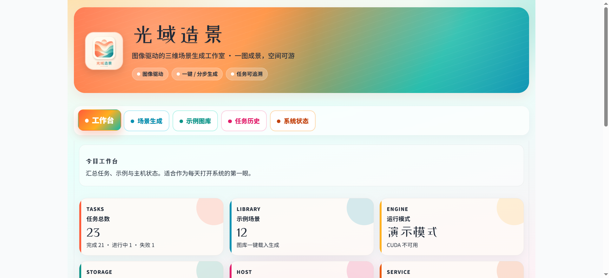
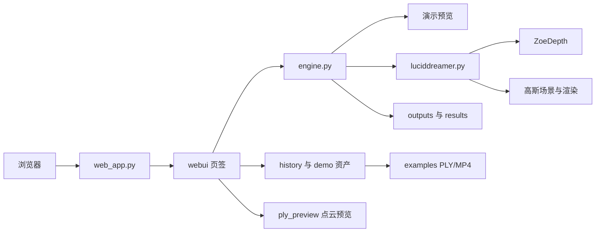
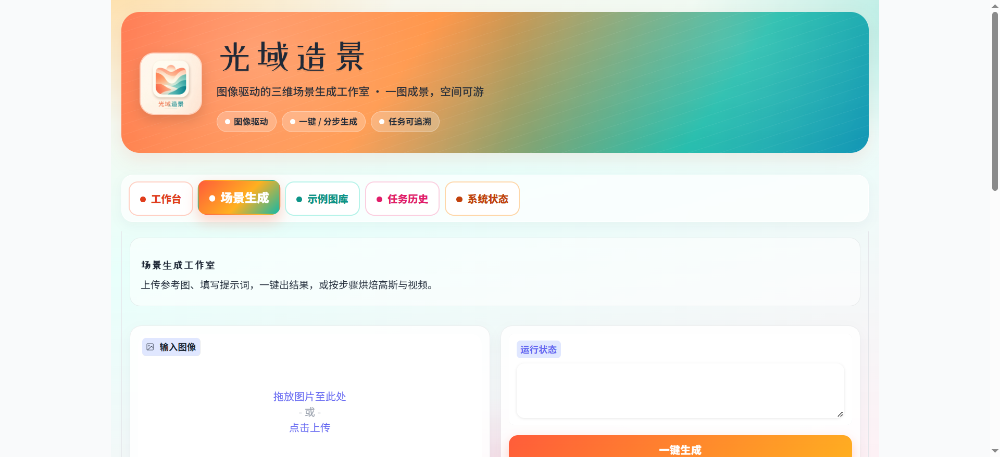
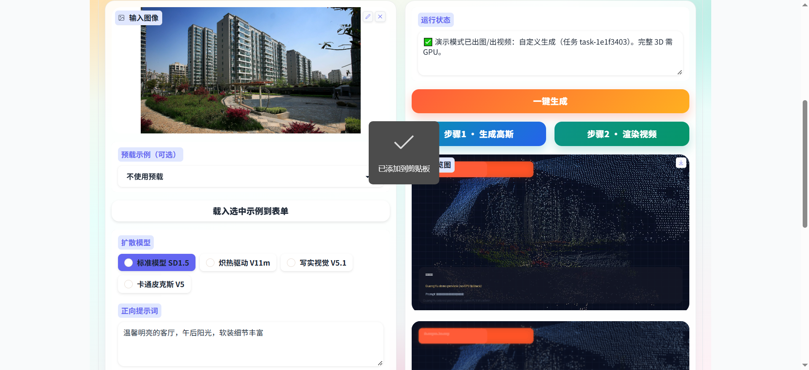
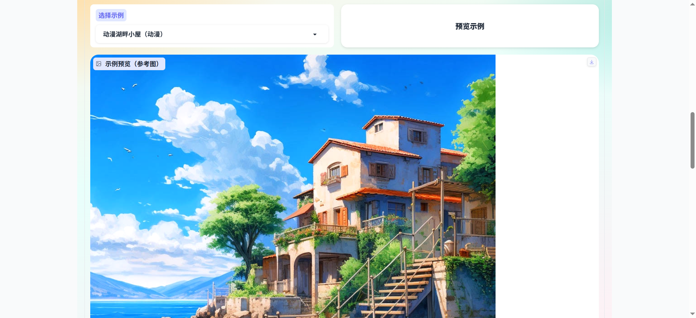
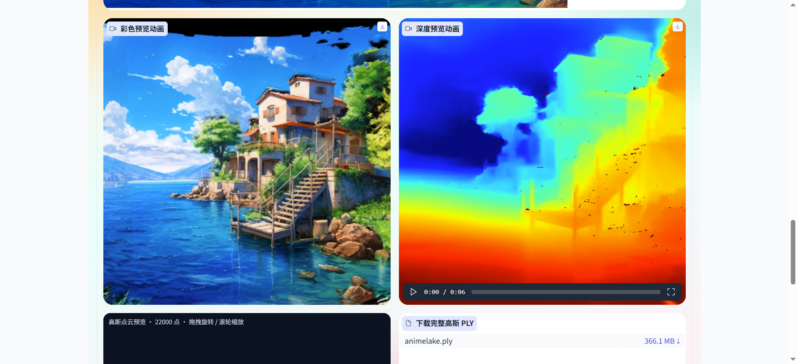
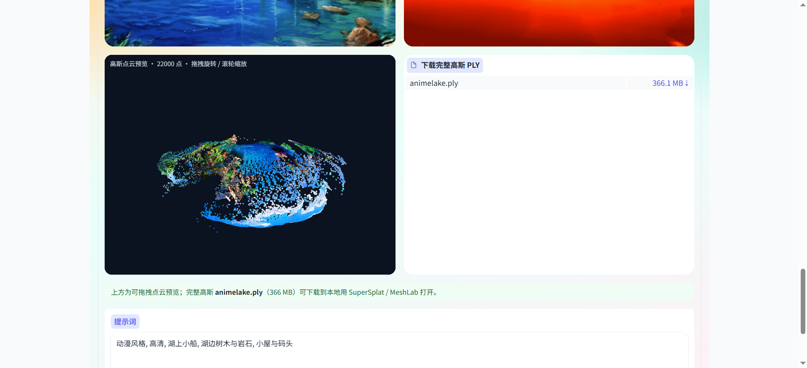
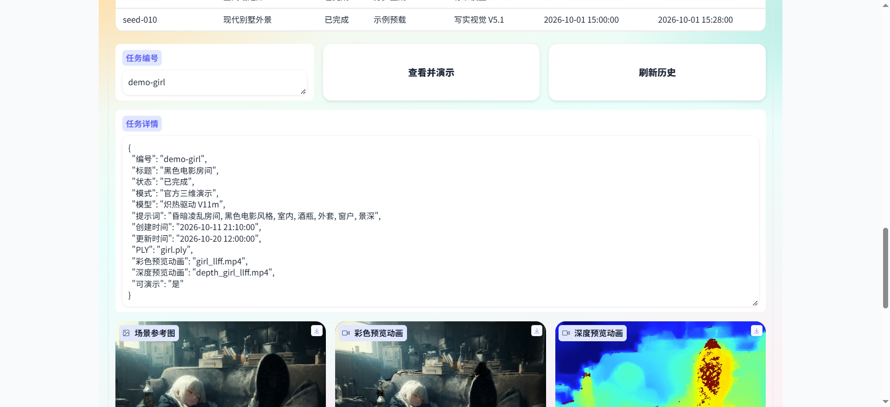
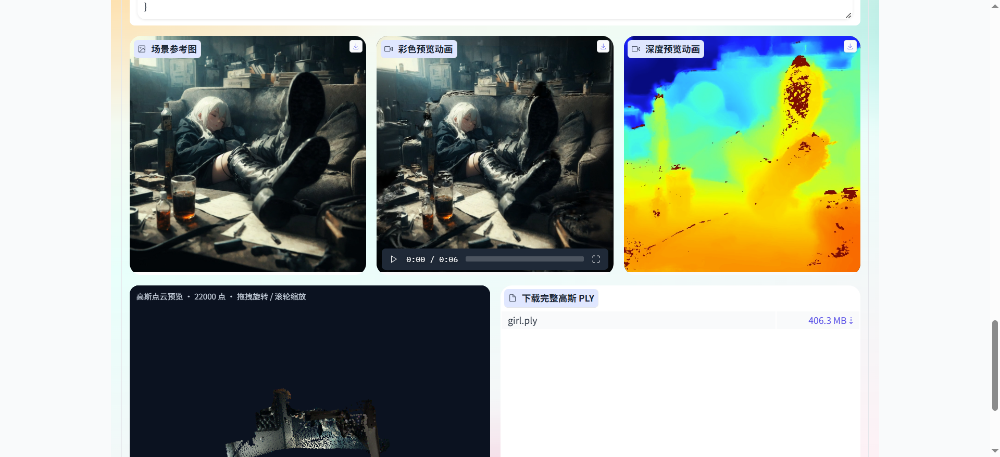
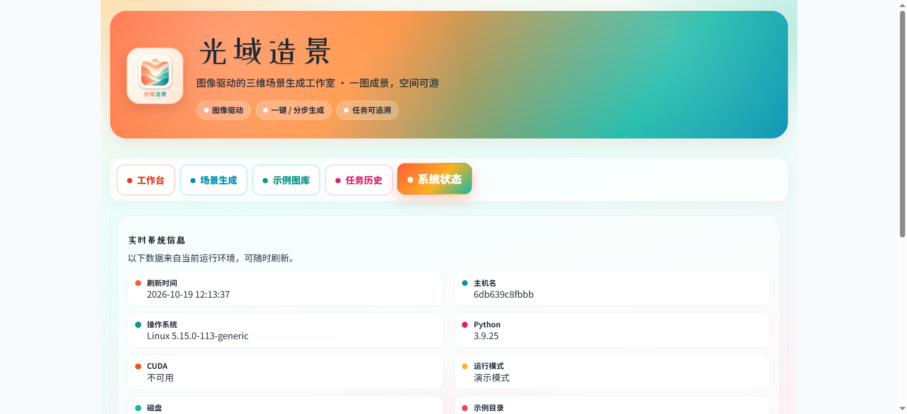

# 项目介绍

光域造景是一套图像驱动的三维场景生成系统。用户提供一张参考图和提示词，系统按相机轨迹生成可预览、可回放、可追溯的场景结果；官方三维演示资产可在浏览器内直接看彩色 / 深度动画与高斯点云。Web 端用 Docker 交付，默认端口 `8090`。



## 1. 项目背景与目标

单张图片很难直接变成可以环顾、推进和交付的空间内容。传统流程要把深度估计、画面补全、三维表达和相机漫游拆给不同工具，创作者难以在一个界面里走完。

光域造景把这条链路收成一个工作室：

- 用参考图和中文提示词描述场景
- 用生成轨迹决定空间怎么被观察，用渲染轨迹决定成片怎么运动
- 产出预览图、彩色动画、深度动画；完整算力下现场烘焙高斯，或直接挂载官方演示 PLY
- 在浏览器内拖拽预览点云，完整模型可下载到 SuperSplat / MeshLab
- 每次任务落库，之后能按编号「查看并演示」

默认以演示模式运行，没有 GPU 时页面、图库三维演示和任务回看仍然可用。具备 CUDA 与模型权重后，可切换到完整三维生成引擎。

## 2. 项目应用场景

- **空间概念设计**：室内、建筑、自然风光先出一版可环顾的效果，再决定是否精修
- **风格化内容**：动漫、奇幻、节日、末日等示例可直接载入，适合风格探索
- **方案沟通**：把静帧、漫游动画和点云预览放在同一页给协作方看
- **教学与演示**：演示模式不依赖 GPU；`demo-*` 官方资产适合课堂与路演
- **三维资产起点**：导出 PLY 高斯点云，供后续查看或加工

## 3. 核心功能概述

系统共五个页签。

**工作台**

汇总任务总数、完成与失败数量、示例场景数、运行模式、CUDA、磁盘、主机和服务端口。点击「刷新系统数据」重新采集。

**场景生成**

- 上传参考图，或从中文示例中载入图片、正负向提示词、模型、种子、步数和相机轨迹
- 扩散模型可选标准模型 SD1.5、炽热驱动 V11m、写实视觉 V5.1、卡通皮克斯 V5
- 生成相机轨迹：环顾四周、俯视环绕、原地旋转 360
- 渲染相机轨迹：来回推进、经典环绕、轻微晃动
- **一键生成**走完预览、彩色动画和深度动画
- **步骤 1 · 生成高斯**只烘焙场景并给出 PLY
- **步骤 2 · 渲染视频**按选定渲染轨迹出彩色与深度动画
- 失败时在状态栏返回可读原因，页面保持可用

**示例图库**

按名称、分类、模型、轨迹和日期列出示例。预览时可同时看到：

- 参考图
- 彩色预览动画、深度预览动画（有官方资产时）
- 可拖拽的高斯点云预览
- 完整 PLY 下载（体积可达数百 MB）

状态中会提示是否「已挂载三维演示资产」。

**任务历史**

生成动作写入 `data/history.json`。预置 `demo-*` 官方三维演示任务。输入编号后点「查看并演示」，可同时看到任务详情、参考图、双路动画、点云预览和 PLY 下载。

**系统状态**

展示主机、操作系统、Python、CUDA、运行模式和数据目录，并给出推荐操作顺序。

演示模式下会基于输入图做预览闭环；图库与历史中的官方 PLY / MP4 可独立演示。`LD_DEMO_MODE=0` 且引擎加载成功时，走 `luciddreamer.py` 完整生成。

## 4. 主要技术栈

| 层次 | 技术 |
| --- | --- |
| 界面 | Gradio 3.50，中文多页签 |
| Web 运行时 | Python 3.9、FastAPI、Starlette、Uvicorn |
| 图像 / 视频 | Pillow、NumPy、imageio |
| 场景生成 | LucidDreamer：扩散补全、深度估计、三维高斯 |
| 深度 | ZoeDepth |
| 高斯渲染 | 3D Gaussian Splatting 光栅化与 simple-knn |
| 点云预览 | `webui/ply_preview.py` 抽稀预览 |
| 任务数据 | 本地 JSON（`data/history.json`） |
| 交付 | Docker Compose；演示镜像与 CUDA 镜像 |

Web 镜像用 `requirements-web.txt`。完整 / CUDA 依赖见 `requirements.txt`、`requirements-cuda.txt`。本机与 CUDA 说明见 [RUN_CUDA.md](RUN_CUDA.md)。

## 4.1 项目代码结构图

```text
guang-yu-zao-jing
├── web_app.py                 Web 入口，监听 8090
├── luciddreamer.py            三维生成主流程
├── Dockerfile                 演示镜像
├── Dockerfile.cuda            CUDA 完整镜像
├── docker-compose.yml         演示编排
├── docker-compose.cuda.yml    CUDA 编排
├── requirements-web.txt       Web 依赖
├── requirements-cuda.txt      CUDA 依赖
├── RUN_CUDA.md / start_*.bat  本机与 CUDA 启动说明
├── webui
│   ├── app.py                 五个页签
│   ├── engine.py              一键 / 分步生成与演示降级
│   ├── catalog.py             示例图库
│   ├── history.py             任务历史与 demo-* 资产
│   ├── ply_preview.py         PLY 抽稀与浏览器预览
│   ├── stats.py / styles.py   工作台统计与样式
│   └── paths.py               数据与输出路径
├── scene / gaussian_renderer  高斯场景与渲染
├── utils / cameras / ZoeDepth
├── submodules                 光栅化与 simple-knn
├── examples                   示例图、提示词、官方 PLY / MP4
├── assets / data / outputs
├── scripts                    部署与本机 CUDA 安装启动
└── docs                       部署文档、用户手册与截图
```



## 5. 系统界面预览

截图均来自 `docs/user/images/`。

**工作台**


**场景生成**





**示例图库 · 参考图与三维演示**







**任务历史 · 查看并演示**





**系统状态**



各页字段与操作顺序见 [用户手册](docs/用户手册.md)。

## 6. 项目使用指南

- [本地 Docker 部署](docs/本地部署.md)
- [生产 Docker 部署](docs/生产部署.md)
- [CUDA / 本机启动](RUN_CUDA.md)
- [用户手册](docs/用户手册.md)
- [模型下载地址](https://huggingface.co/ironjr/models)

### 6.1 环境要求

- Docker Engine 24 及以上，且可使用 `docker compose`
- 本机或服务器放行 `8090`
- 内存建议 8 GB 及以上；官方 PLY 演示另需数 GB 磁盘
- 演示模式（`LD_DEMO_MODE=1`）不需要 GPU，用默认 `Dockerfile` 即可
- `LD_DEMO_MODE=0` 需要 NVIDIA GPU（建议 16 GB 显存）、NVIDIA Container Toolkit 或本机 CUDA 环境、`requirements-cuda.txt` / CUDA 版 PyTorch，以及编译 `submodules/simple-knn` 与 `submodules/depth-diff-gaussian-rasterization-min`
- 完整模式启动时会下载扩散与 ZoeDepth 权重，缓存建议预留 30 GB；条件不齐时自动退回演示模式

### 6.2 启动步骤

演示（无 GPU / 默认）：

```bash
docker compose up -d --build
```

有 GPU 的 Linux 服务器：

```bash
docker compose -f docker-compose.cuda.yml up -d --build
```

本机 Windows 也可双击 `start_demo.bat` / `start_cuda.bat`，或见 [RUN_CUDA.md](RUN_CUDA.md)。

查看日志与停止：

```bash
docker compose logs -f
docker compose down
```

### 6.3 访问地址

本机：

```text
http://127.0.0.1:8090
```

服务器：

```text
http://<服务器IP>:8090
```

### 6.4 默认账号说明

系统不设登录。浏览器能打开上述地址即可使用。生产环境请用防火墙或反向代理限制访问来源。

## 7. 典型使用流程

1. 打开工作台，确认运行模式和磁盘剩余。
2. 在示例图库选择「动漫湖畔小屋」等条目，点「预览示例」，查看参考图、双路动画和点云；需要时下载完整 PLY。
3. 或在任务历史输入 `demo-animelake` / `demo-girl`，点「查看并演示」。
4. 进入场景生成，载入示例或上传图片，确认模型、提示词、生成轨迹和渲染轨迹。
5. 点击「一键生成」。只烘焙空间用「步骤 1 · 生成高斯」；改镜头用「步骤 2 · 渲染视频」。
6. 在结果区查看预览，再到任务历史用新编号回看详情与媒体。
