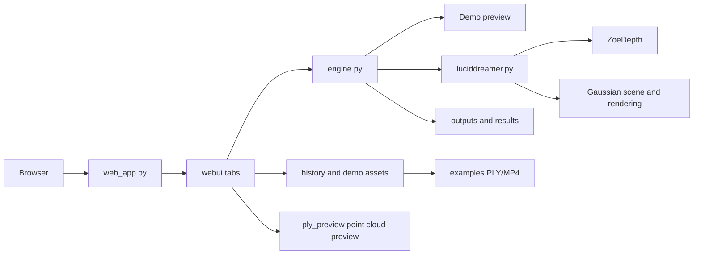

# DeepOpen

中文  [中文说明](https://github.com/deepopen-com/deepopen-3d-webs/blob/main/README-cn.md)


# Project Overview

Guangyu Zaojing (光域造景) is an image-driven 3D scene generation system. You supply one reference image and a prompt, and the system generates scene results along a camera trajectory that you can preview, replay, and trace. The official 3D demo assets play color/depth animations and Gaussian point clouds directly in the browser. The web app ships as a Docker image and listens on port `8090` by default.


## 1. Background and Goals

A single image rarely turns into spatial content you can look around in, move through, and hand off. The traditional pipeline splits depth estimation, image completion, 3D representation, and camera flythrough across separate tools, so creators can't carry a scene from start to finish in one interface.

Guangyu Zaojing collapses that chain into a single studio:

- Describe a scene with a reference image and a Chinese prompt
- Use a generation trajectory to decide how the space is observed, and a render trajectory to decide how the final footage moves
- Produce preview stills, color animations, and depth animations; bake Gaussians on the fly with full compute, or mount the official demo PLY directly
- Drag to preview point clouds in the browser, and download complete models for SuperSplat / MeshLab
- Every task is persisted, so you can later "View & Demo" it by ID

The system runs in demo mode by default. Without a GPU, the pages, the gallery's 3D demos, and task replay all remain usable. With CUDA and model weights available, you can switch to the full 3D generation engine.

## 2. Use Cases

- **Spatial concept design**: Get a look-around version of an interior, building, or natural landscape before deciding whether to invest in refinement
- **Stylized content**: Anime, fantasy, holiday, and post-apocalyptic presets load in directly — well suited to style exploration
- **Design reviews**: Put stills, flythrough footage, and point-cloud previews on one page for collaborators
- **Teaching and demos**: Demo mode needs no GPU; the official `demo-*` assets work well in classrooms and pitch sessions
- **A starting point for 3D assets**: Export PLY Gaussian point clouds for downstream viewing or processing

## 3. Core Features

The system has five tabs.

**Workbench**

Summarizes total tasks, completed and failed counts, sample scene count, run mode, CUDA, disk, host, and service port. Click "Refresh System Data" to re-collect.

**Scene Generation**

- Upload a reference image, or load an image, positive/negative prompts, model, seed, steps, and camera trajectory from a Chinese example
- Diffusion model options: the standard SD1.5, Blazing Drive V11m, Realistic Vision V5.1, Cartoon Pixar V5
- Generation trajectories: Look Around, Overhead Orbit, Spin in Place 360
- Render trajectories: Push In and Out, Classic Orbit, Subtle Sway
- **One-Click Generate** runs preview, color animation, and depth animation end to end
- **Step 1 · Generate Gaussians** bakes the scene only and returns a PLY
- **Step 2 · Render Video** produces color and depth animations along the selected render trajectory
- On failure, the status bar returns a readable reason and the page stays usable

**Example Gallery**

Lists examples by name, category, model, trajectory, and date. Previews show, together:

- The reference image
- Color preview animation and depth preview animation (when official assets exist)
- A draggable Gaussian point cloud preview
- Full PLY download (files can reach hundreds of MB)

The status line indicates whether the 3D demo assets are mounted.

**Task History**

Generation actions are written to `data/history.json`. Official `demo-*` 3D demo tasks are preloaded. Enter an ID and click "View & Demo" to see task details, the reference image, both animations, the point cloud preview, and the PLY download together.

**System Status**

Shows host, OS, Python, CUDA, run mode, and the data directory, along with the recommended order of operations.

In demo mode, the preview loop runs on the input image; the official PLY / MP4 assets in the gallery and history can be demoed independently. When `LD_DEMO_MODE=0` and the engine loads successfully, the full `luciddreamer.py` pipeline runs.

## 4. Tech Stack

| Layer               | Technology                                                         |
| ------------------- | ------------------------------------------------------------------ |
| UI                  | Gradio 3.50, multi-tab, Chinese                                    |
| Web runtime         | Python 3.9, FastAPI, Starlette, Uvicorn                            |
| Image / video       | Pillow, NumPy, imageio                                             |
| Scene generation    | LucidDreamer: diffusion inpainting, depth estimation, 3D Gaussians |
| Depth               | ZoeDepth                                                           |
| Gaussian rendering  | 3D Gaussian Splatting rasterization and simple-knn                 |
| Point cloud preview | Down-sampling preview via `webui/ply_preview.py`                   |
| Task data           | Local JSON (`data/history.json`)                                   |
| Delivery            | Docker Compose; demo image and CUDA image                          |

The web image uses `requirements-web.txt`. Full / CUDA dependencies are in `requirements.txt` and `requirements-cuda.txt`. Local machine and CUDA notes are in [RUN\_CUDA.md](RUN_CUDA.md).

## 4.1 Code Structure

```text
guang-yu-zao-jing
├── web_app.py                 Web entry point, listens on 8090
├── luciddreamer.py            Main 3D generation pipeline
├── Dockerfile                 Demo image
├── Dockerfile.cuda            Full CUDA image
├── docker-compose.yml         Demo orchestration
├── docker-compose.cuda.yml    CUDA orchestration
├── requirements-web.txt       Web dependencies
├── requirements-cuda.txt      CUDA dependencies
├── RUN_CUDA.md / start_*.bat  Local and CUDA start guide
├── webui
│   ├── app.py                 Five tabs
│   ├── engine.py              One-click / step-by-step generation and demo fallback
│   ├── catalog.py             Example gallery
│   ├── history.py             Task history and demo-* assets
│   ├── ply_preview.py         PLY down-sampling and browser preview
│   ├── stats.py / styles.py   Workbench stats and styling
│   └── paths.py               Data and output paths
├── scene / gaussian_renderer  Gaussian scene and rendering
├── utils / cameras / ZoeDepth
├── submodules                 Rasterization and simple-knn
├── examples                   Example images, prompts, official PLY / MP4
├── assets / data / outputs
├── scripts                    Deployment and local CUDA install/start scripts
└── docs                       Deployment docs, user manual, and screenshots
```



## 5. UI Preview

All screenshots are from `docs/user/images/`.

**Workbench**


**Scene Generation**


**Example Gallery · Reference image and 3D demo**


**Task History · View & Demo**


**System Status**


Field descriptions and the order of operations for each tab are in the [User Manual](docs/用户手册.md).

## 6. Getting Started

- [Local Docker deployment](docs/本地部署.md)
- [Production Docker deployment](docs/生产部署.md)
- [CUDA / local machine startup](RUN_CUDA.md)
- [User Manual](docs/用户手册.md)
- [Model download](https://huggingface.co/ironjr/models)

### 6.1 Requirements

- Docker Engine 24 or later, with `docker compose` available
- Port `8090` open on the local machine or server
- 8 GB of RAM or more recommended; official PLY demos need several additional GB of disk
- Demo mode (`LD_DEMO_MODE=1`) needs no GPU — the default `Dockerfile` is enough
- `LD_DEMO_MODE=0` requires an NVIDIA GPU (16 GB VRAM recommended), the NVIDIA Container Toolkit or a local CUDA environment, `requirements-cuda.txt` / the CUDA build of PyTorch, and compiled `submodules/simple-knn` and `submodules/depth-diff-gaussian-rasterization-min`
- Full mode downloads the diffusion and ZoeDepth weights on startup; allow about 30 GB of cache. If any requirement is missing, it falls back to demo mode automatically

### 6.2 Startup

Demo (no GPU / default):

```bash
docker compose up -d --build
```

Linux server with GPU:

```bash
docker compose -f docker-compose.cuda.yml up -d --build
```

On Windows you can also double-click `start_demo.bat` / `start_cuda.bat`, or follow [RUN\_CUDA.md](RUN_CUDA.md).

View logs and stop:

```bash
docker compose logs -f
docker compose down
```

### 6.3 Access

Local:

```text
http://127.0.0.1:8090
```

Server:

```text
http://<server-ip>:8090
```

### 6.4 Accounts

There is no login. Anyone who can open the address above in a browser can use the system. In production, restrict access by source with a firewall or reverse proxy.

## 7. Typical Workflow

1. Open the workbench and confirm the run mode and free disk space.
2. In the example gallery, pick an entry such as "Anime Lakeside Cabin" and click "Preview Example" to see the reference image, both animations, and the point cloud; download the full PLY if you need it.
3. Or, in task history, enter `demo-animelake` / `demo-girl` and click "View & Demo".
4. Go to Scene Generation, load an example or upload an image, and confirm the model, prompts, generation trajectory, and render trajectory.
5. Click "One-Click Generate". To bake the space only, use "Step 1 · Generate Gaussians"; to change the camera moves, use "Step 2 · Render Video".


6. Check the preview in the results area, then look up the details and media under the new task ID in Task History.
