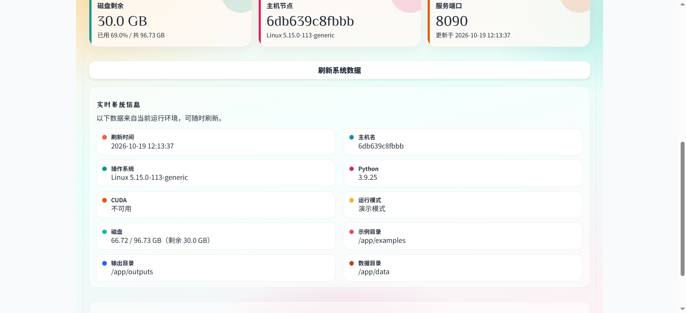
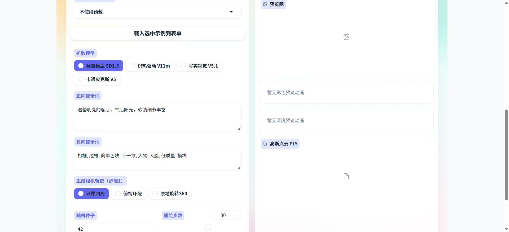
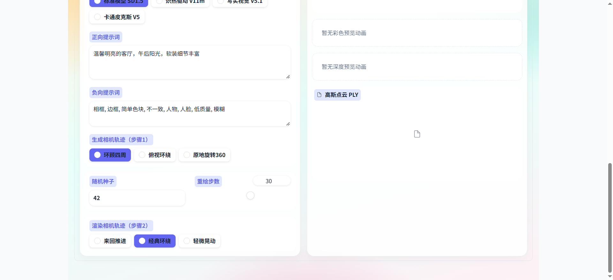
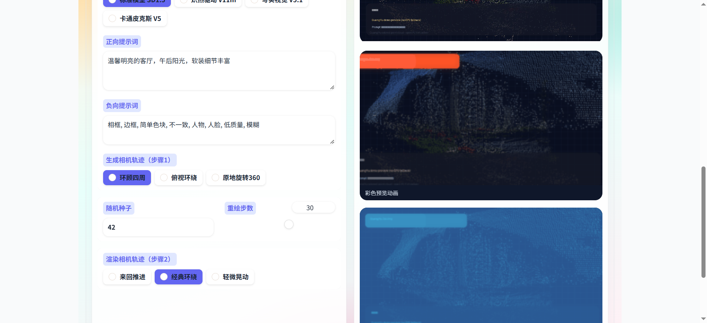
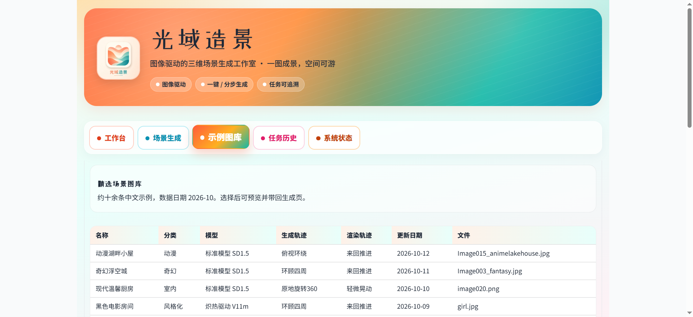
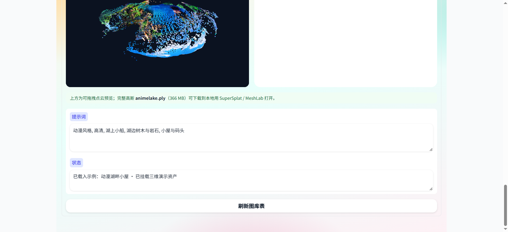
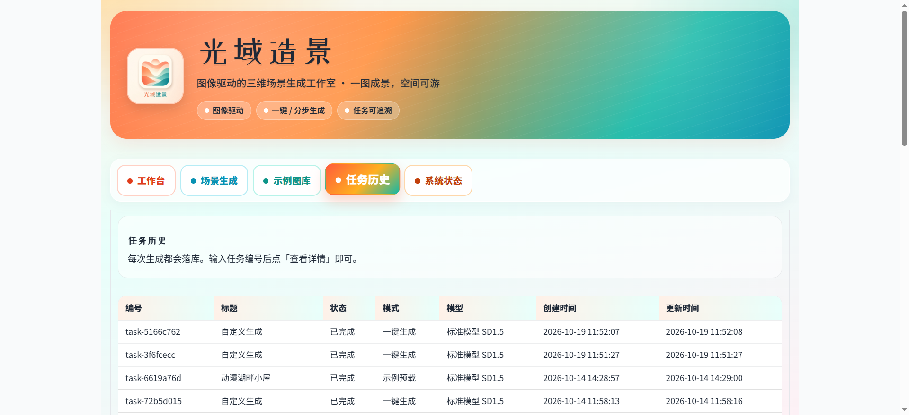
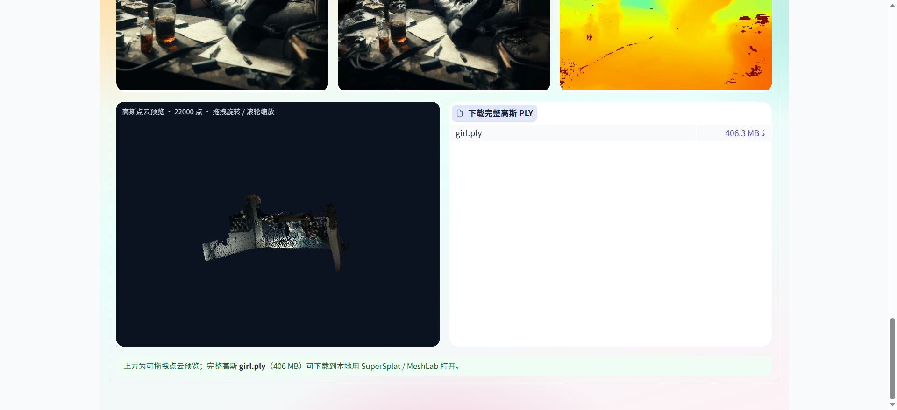
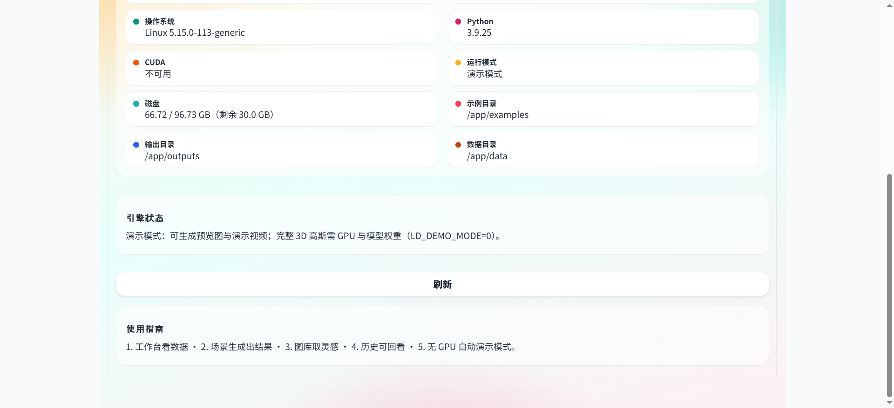

# 光域造景 · 用户手册

光域造景是图像驱动的三维场景生成工作室。准备一张参考图和一段提示词，即可生成场景预览、彩色动画、深度动画，并在完整算力模式或官方演示资产下得到高斯点云。每次生成都会写入任务历史。

浏览器打开服务地址即可使用，没有登录账号。本地默认为 `http://127.0.0.1:8090`。

界面顶部是品牌区，下面有五个页签：**工作台**、**场景生成**、**示例图库**、**任务历史**、**系统状态**。

## 1. 工作台

打开系统后默认进入工作台，用来看当天的业务和主机概况。

六张统计卡：

| 卡片 | 含义 |
| --- | --- |
| 任务总数 | 历史任务数量，并拆出完成、进行中、失败 |
| 示例场景 | 图库中可载入的示例条数 |
| 运行模式 | 演示模式或完整算力，以及 CUDA 是否可用 |
| 磁盘剩余 | 当前磁盘剩余空间和占用比例 |
| 主机节点 | 运行服务的机器名和操作系统 |
| 服务端口 | 当前 Web 端口和刷新时间 |

卡片下方是实时系统信息：刷新时间、主机名、操作系统、Python、CUDA、运行模式、磁盘、示例目录、输出目录、数据目录。再往下是引擎状态。

点击 **刷新系统数据** 会重新采集上述内容。

引擎状态常见说明：

- 演示模式：可生成预览图与演示视频；官方三维演示资产仍可在图库和历史里播放与预览点云。
- 完整算力模式：三维生成引擎已加载，可现场烘焙真实高斯。

完整算力对应 `LD_DEMO_MODE=0`，需要 NVIDIA GPU、CUDA 版依赖、已编译扩展和模型权重。条件未齐时页面会自动留在演示模式。详见 [本地部署](本地部署.md)、[生产部署](生产部署.md) 与 [RUN_CUDA.md](../RUN_CUDA.md)。

## 2. 场景生成

这是主要操作页。左侧填写条件，右侧查看结果。

### 2.1 输入

| 字段 | 说明 |
| --- | --- |
| 输入图像 | 上传参考图，作为场景的视觉起点 |
| 预载示例 | 从内置图库选一条，或保持「不使用预载」 |
| 载入选中示例到表单 | 把该示例的图片、提示词、模型、轨迹、种子和步数填进表单 |
| 扩散模型 | 标准模型 SD1.5、炽热驱动 V11m、写实视觉 V5.1、卡通皮克斯 V5 |
| 正向提示词 | 希望画面里出现的内容 |
| 负向提示词 | 希望避开的内容，默认已填入相框、人脸、模糊等 |
| 生成相机轨迹 | 环顾四周、俯视环绕、原地旋转360 |
| 随机种子 | 同一张图、同一提示词、同一种子，结果更稳定 |
| 重绘步数 | 1 到 50，默认 30 |
| 渲染相机轨迹 | 来回推进、经典环绕、轻微晃动 |

### 2.2 三种运行方式

**一键生成**

按当前表单跑完整流程：记录任务、给出预览图、彩色预览动画、深度预览动画。完整算力模式下还会给出高斯点云 PLY。

**步骤 1 · 生成高斯**

只做场景烘焙，得到预览图和 PLY，不渲染漫游视频。

**步骤 2 · 渲染视频**

在已有场景上按「渲染相机轨迹」出彩色动画和深度动画。建议先完成步骤 1，或先做过一次一键生成。

### 2.3 结果区

| 区域 | 内容 |
| --- | --- |
| 运行状态 | 成功或失败说明 |
| 预览图 | 当前场景的静帧 |
| 彩色预览动画 | 按渲染轨迹生成的彩色结果 |
| 深度预览动画 | 对应的深度结果 |
| 高斯点云 PLY | 可下载的三维高斯文件 |

## 3. 示例图库

图库收录十余条中文示例。有官方三维演示资产的条目，预览时除参考图外，还会挂载彩色动画、深度动画、可拖拽点云预览，以及完整 PLY 下载。

操作：

1. 在「选择示例」里选一条，例如「动漫湖畔小屋（动漫）」。
2. 点击 **预览示例**。
3. 查看参考图、彩色预览动画、深度预览动画。
4. 在「高斯点云预览」中拖拽旋转、滚轮缩放；需要完整模型时，在右侧下载 PLY。
5. 回到「场景生成」，用同一示例载入表单后再改参数生成。

状态栏出现「已挂载三维演示资产」表示该示例的 PLY / MP4 已就绪。页面提示完整高斯可用 **SuperSplat** 或 **MeshLab** 打开。

点击 **刷新图库表** 会按当前示例文件重新列表。

## 4. 任务历史

每次一键生成、分步生成都会留下记录。系统还预置了 `demo-*` 官方三维演示任务（如 `demo-animelake`、`demo-girl`、`demo-doge`），可直接查看并演示。

查看某条记录：

1. 点击 **刷新历史**，从表格抄下编号。
2. 把编号填进「任务编号」，例如 `demo-girl`。
3. 点击 **查看并演示**。

详情区会给出编号、标题、状态、模式、模型、提示词、时间，以及 PLY、彩色结果、深度结果文件名和是否可演示。下方同时展示：

- 场景参考图
- 彩色预览动画
- 深度预览动画
- 高斯点云预览（轻量点云，可拖拽）
- 下载完整高斯 PLY

浏览器内点云是抽稀预览（例如约两万点），完整高斯体积可达数百 MB（如 `girl.ply` 约 406 MB、`animelake.ply` 约 366 MB）。下载后用 SuperSplat 或 MeshLab 打开。

你自己跑出来的任务编号形如 `task-` 加随机串。状态一般为：已完成、进行中、失败。

## 5. 系统状态

这一页集中看运行环境，字段与工作台下方的系统信息相同。

推荐操作顺序：

1. 工作台看数据
2. 场景生成出结果
3. 图库取灵感，并预览三维演示资产
4. 历史里「查看并演示」回看
5. 无 GPU 时自动处于演示模式；完整烘焙需满足 CUDA 条件

点击 **刷新** 更新系统和引擎状态。

## 6. 一条完整用法

1. 打开工作台，确认运行模式和磁盘剩余。
2. 进入示例图库，选择「动漫湖畔小屋」或「黑色电影房间」，点 **预览示例**，先看彩色 / 深度动画和点云。
3. 或进入任务历史，输入 `demo-animelake` / `demo-girl`，点 **查看并演示**，下载完整 PLY。
4. 进入场景生成，载入同一示例或上传自己的图片，确认模型、提示词和轨迹。
5. 点击 **一键生成**。若只要烘焙空间，用「步骤 1 · 生成高斯」；改镜头用「步骤 2 · 渲染视频」。
6. 在结果区查看预览；再回任务历史用新编号回看。

比较同一场景的不同镜头时，只改渲染轨迹后点「步骤 2」。换构图时改生成轨迹后从「步骤 1」重新开始。
